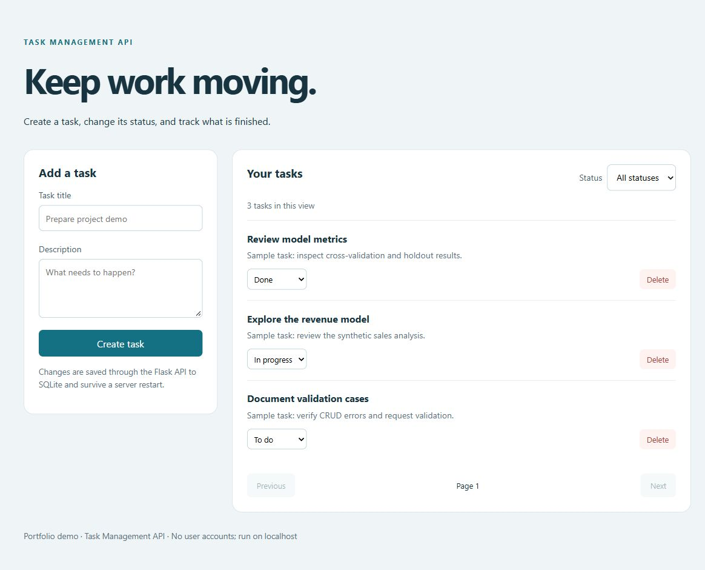
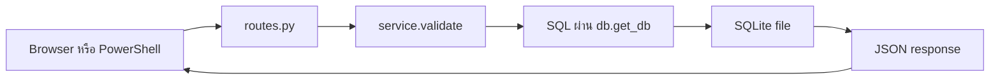

# Task Management API — เรียนการทำเว็บ API ตั้งแต่ศูนย์

คู่มือนี้อธิบายโค้ดใน repo `task-management-api` สำหรับนักศึกษาที่เพิ่งเริ่ม Python และ backend อ่านตามลำดับแล้วลงมือทำแต่ละขั้นได้เลย โฟลเดอร์ของ repo นี้ในเครื่องปัจจุบันยังชื่อ `restful-web-service`

## 1. เรียนแล้วจะทำอะไรได้

- อธิบายว่า browser, server, API และ database ทำงานร่วมกันอย่างไร
- สร้าง อ่าน แก้ไข และลบงานผ่าน HTTP ด้วยตัวเอง
- ตามโค้ดหนึ่ง request ตั้งแต่รับข้อมูลจนบันทึก SQLite
- แยก input validation, transaction และ automated test ออกจากกันได้

โปรเจกต์นี้จัดการ **รายการงาน** เช่น “เตรียม demo” แต่ละงานมีชื่อ คำอธิบาย และสถานะ `todo`, `in_progress` หรือ `done` ระบบมีทั้งหน้าเว็บและ API ข้อมูลยังอยู่หลังปิดแล้วเปิด server ใหม่



## 2. What / Why / How ของระบบ

| ประเด็น | What: คืออะไร | Why: ทำไมใช้ | How: ในโค้ดนี้ทำอย่างไร |
|---|---|---|---|
| REST API | ช่องทางรับส่งข้อมูลผ่าน HTTP | ให้ UI หรือโปรแกรมอื่นจัดการงานได้ | routes แยกตาม method และ URL |
| CRUD | Create, Read, Update, Delete | ครอบคลุมวงจรข้อมูลพื้นฐาน | POST, GET, PATCH, DELETE |
| Validation | ตรวจชนิดและขอบเขตข้อมูล | ป้องกันข้อมูลไม่ตรงกติกา | `service.validate()` ก่อนเขียน DB |
| Persistence | เก็บข้อมูลให้ข้ามการรันได้ | ปิดโปรแกรมแล้วงานไม่หาย | SQLite เขียนลงไฟล์ |
| Separation of concerns | แบ่งหน้าที่ของโค้ด | เปลี่ยนส่วนหนึ่งได้ง่าย | routes → service → db |

## 3. พื้นฐานที่ต้องรู้ก่อน

**Client** คือผู้ส่งคำขอ เช่น browser หรือ PowerShell ส่วน **server** คือโปรแกรม Flask ที่รอรับคำขอ `127.0.0.1` หมายถึงเครื่องของเรา และ `5001` คือ port ที่แยกบริการนี้จากโปรแกรมอื่น

HTTP request มี method, URL, headers และอาจมี body เช่น POST ส่งข้อมูลใหม่ใน body ส่วน response มี status code, headers และ body กลับมา API จึงไม่ได้หมายถึงหน้าเว็บที่มีปุ่มเสมอไป

**JSON** เป็นรูปแบบข้อความสำหรับแลกเปลี่ยนข้อมูล:

```json
{"title": "Prepare demo", "status": "todo"}
```

ใน Python ข้อมูลลักษณะนี้ใช้ `dict` เช่น `payload["title"]` เพื่ออ่านค่า ส่วน `list` เก็บหลายรายการ เช่นรายการงานที่ API ส่งกลับ `None` หมายถึงไม่มีค่า และ `raise` ใช้แจ้งข้อผิดพลาดให้ผู้เรียกจัดการ

**Function** คือชุดคำสั่งที่มีชื่อ เช่น `get_task(task_id)` รับ ID แล้วคืนข้อมูล ฟังก์ชันช่วยให้เราไม่ต้องเขียน SQL ซ้ำทุก route ส่วน `import` นำฟังก์ชันจากอีกไฟล์เข้ามาใช้

**Database** จัดข้อมูลเป็นตาราง ในที่นี้หนึ่งแถวคืองานหนึ่งรายการ `id` เป็น primary key ใช้ระบุงานไม่ซ้ำ ชื่อเหมือนกันได้ แต่ ID ต่างกัน SQLite ไม่ต้องเปิด database server แยก เพราะอ่านเขียนไฟล์ผ่าน Python ได้

## 4. เครื่องมือและไฟล์สำคัญ

| เครื่องมือ/ไฟล์ | หน้าที่ |
|---|---|
| Python | ภาษาที่เขียน backend |
| Flask + Werkzeug | รับ HTTP, routing และข้อผิดพลาด HTTP |
| `sqlite3` | ติดต่อ SQLite; อยู่ใน standard library ของ Python |
| HTML / CSS / JavaScript | โครงหน้าเว็บ รูปแบบ และการเรียก API |
| pytest | รันการทดสอบอัตโนมัติ |
| Ruff | ตรวจปัญหาโค้ดบางประเภทและจัดรูปแบบ |
| Git / GitHub | เก็บประวัติการเปลี่ยนแปลงและเผยแพร่ source |
| `pyproject.toml` | ชื่อแพ็กเกจ dependency และการตั้งค่าเครื่องมือ |
| `src/task_api/__init__.py` | `create_app()` สร้างและตั้งค่า Flask |
| `src/task_api/routes.py` | รับ request และเลือกรูปแบบ response |
| `src/task_api/service.py` | ตรวจข้อมูลและทำ CRUD |
| `src/task_api/db.py` | เปิด connection, สร้างตาราง และปิด connection |
| `src/task_api/static/app.js` | รับการกดปุ่มแล้วใช้ `fetch()` เรียก API |
| `tests/test_api.py` | ตัวอย่างความต้องการที่ตรวจด้วยโปรแกรม |

`src` เก็บ source ส่วน `tests` เก็บวิธีตรวจพฤติกรรม ไม่ควรใส่โค้ดของโปรเจกต์ไว้ใน `.venv`

## 5. Step by step: เตรียมและเปิดระบบ

### ขั้นที่ 1 — เปิด PowerShell ในโฟลเดอร์ repo

ถ้าเริ่มใน `ProfileProject` ให้ใช้:

```powershell
Set-Location .\restful-web-service
python --version
```

ต้องมี Python 3.11 ขึ้นไป ถ้า clone จากชื่อ repo ใหม่ โฟลเดอร์จะชื่อ `task-management-api` ให้เข้าโฟลเดอร์นั้นแทน `Set-Location` คือเปลี่ยน working directory คำสั่งต่อไปอ้างอิงจากตำแหน่งนี้

### ขั้นที่ 2 — สร้าง environment และติดตั้ง

```powershell
python -m venv .venv
.\.venv\Scripts\python.exe -m pip install -e ".[dev]"
```

`.venv` แยก library ของโปรเจกต์ออกจาก Python ตัวอื่น `-m` คือเรียก module, `pip` ติดตั้งแพ็กเกจ, `-e` คือ editable install ซึ่งอ่าน source จากโฟลเดอร์เรา และ `[dev]` เพิ่ม pytest/Ruff ตาม `pyproject.toml` ไม่จำเป็นต้อง activate เพราะเราเรียก Python ใน environment โดยตรง

เครื่องนี้มี environment ร่วมที่เตรียมไว้แล้วที่ `ProfileProject/.venv` หากใช้ตัวนั้น ให้แทน `.\.venv\Scripts\python.exe` ด้วย `..\.venv\Scripts\python.exe` ในคำสั่งหลังจากเข้า repo ไม่ต้องติดตั้งซ้ำ

### ขั้นที่ 3 — เริ่ม server

```powershell
.\.venv\Scripts\python.exe -m flask --app task_api run --port 5001
```

เปิด `http://127.0.0.1:5001` ใน browser จะเห็นฟอร์มสร้างงาน Terminal นี้ต้องเปิดค้างไว้ ถ้าจะรันคำสั่ง API ให้เปิด PowerShell อีกหน้าต่าง `Ctrl+C` ใช้หยุด server

### ขั้นที่ 4 — ใช้หน้าเว็บ

สร้างงาน เปลี่ยนสถานะเป็น In progress แล้ว reload หน้าเว็บ ข้อมูลควรยังอยู่ ลองหยุดแล้วเปิด server ใหม่เพื่อพิสูจน์ว่าข้อมูลอยู่ใน SQLite ไม่ได้อยู่เฉพาะ JavaScript ในหน้าเว็บ

## 6. Step by step: เรียก API โดยไม่ใช้หน้าเว็บ

รันใน PowerShell หน้าต่างที่สอง ขณะ server ทำงานอยู่:

```powershell
# 1) Create: รับงานที่สร้างกลับมาและเก็บ ID จริง
$demoTask = Invoke-RestMethod 'http://127.0.0.1:5001/api/tasks' -Method Post -ContentType 'application/json' -Body '{"title":"Learn REST API","description":"Practice CRUD"}'
$demoTask | ConvertTo-Json

# 2) Read: ดึงงานนี้ด้วย ID ของมัน
Invoke-RestMethod "http://127.0.0.1:5001/api/tasks/$($demoTask.id)"

# 3) Update: ส่งเฉพาะ field ที่จะเปลี่ยน
Invoke-RestMethod "http://127.0.0.1:5001/api/tasks/$($demoTask.id)" -Method Patch -ContentType 'application/json' -Body '{"status":"done"}'

# 4) List: ดูงานสถานะ done พร้อม pagination
Invoke-RestMethod 'http://127.0.0.1:5001/api/tasks?status=done&page=1&per_page=5'

# 5) Delete: ลบเฉพาะงานตัวอย่างที่เพิ่งสร้าง
Invoke-RestMethod "http://127.0.0.1:5001/api/tasks/$($demoTask.id)" -Method Delete
```

`Content-Type: application/json` บอก server ว่า body เป็น JSON `$demoTask.id` อ่าน ID ที่ server สร้าง จึงไม่ต้องเดาว่างานของเราคือ ID 1 และ DELETE สำเร็จจะไม่มี JSON body กลับมา

| Status | ความหมายในโปรเจกต์นี้ |
|---|---|
| 200 | อ่านหรือแก้ไขสำเร็จ |
| 201 | สร้างสำเร็จ; `Location` ชี้ URL ของงานใหม่ |
| 204 | ลบสำเร็จ; ไม่มี body |
| 400 | ข้อมูลหรือ query ไม่ตรงกติกา |
| 404 | ไม่มี route หรืองานที่ขอ |
| 405 | method ไม่รองรับ เช่น PUT ที่ `/health` |
| 413 | request body ใหญ่กว่า 16 KiB |
| 415 | ไม่ได้ส่ง body เป็น JSON content type |

การ list คืน `items`, `page`, `per_page`, `total` โดย `total` คือจำนวนทั้งหมดที่ตรงตัวกรอง ไม่ใช่แค่จำนวนในหน้าปัจจุบัน ค่าเริ่มต้น 20 รายการต่อหน้า สูงสุด 100 และเรียง ID ใหม่ก่อน

## 7. เดินตามหนึ่ง request ใน source



ลองตาม POST `/api/tasks`:

1. `create_app()` สร้าง app ตั้ง `DATABASE` และลงทะเบียน Blueprint ที่ prefix `/api/tasks` Blueprint คือกลุ่ม route ที่นำไปประกอบใน app ได้
2. `routes.create_task()` อ่าน JSON ด้วย `request.get_json()` แล้วส่งให้ service
3. `service.validate()` บังคับ title เป็น string 1–120 ตัวอักษรหลัง trim ตรวจ description ไม่เกิน 2,000 ตัว และ status อยู่ในสามค่าที่อนุญาต Unknown field จะถูกปฏิเสธ
4. `create_task()` ขอ connection แล้ว INSERT ด้วย SQL parameter จากนั้นอ่านแถวใหม่กลับมา
5. route คืนข้อมูลพร้อม 201 และ `Location` Flask แปลง dict เป็น JSON
6. เมื่อจบ request `teardown_appcontext` เรียก `close_db()` เพื่อคืน resource

### ทำไมใช้ `?` ใน SQL

```python
connection.execute("SELECT * FROM tasks WHERE id = ?", (task_id,))
```

`task_id` เป็นข้อมูลแยกจากคำสั่ง SQL ถ้าต่อข้อความผู้ใช้เข้า SQL โดยตรง ข้อความอาจกลายเป็นคำสั่งได้ นี่คือเหตุผลของ parameterized query เครื่องหมายจุลภาคใน `(task_id,)` ทำให้เป็น tuple หนึ่งสมาชิก

PATCH สร้างชื่อ field ใน SQL แบบ dynamic ได้เพราะชื่อเหล่านั้นผ่าน allowlist มาแล้ว ส่วน **ค่า** ยังใช้ parameter ไม่ได้เอาค่าผู้ใช้ไปต่อ SQL

### ทำไมใช้ transaction และ connection ต่อ request

`with connection:` จัดการ commit เมื่อทำสำเร็จและ rollback เมื่อเกิด exception ช่วยไม่ให้เหลือการเปลี่ยนแปลงเพียงครึ่งเดียว **แต่ไม่ได้ปิด connection** การปิดเป็นหน้าที่ของ teardown ใน `db.py`

Flask `g` เป็นที่เก็บข้อมูลของ application context ปัจจุบัน โค้ดเก็บ connection ไว้ที่ `g.db` เพื่อใช้ซ้ำภายใน request เดียว ไม่แชร์ connection เดียวข้ามทุก request

ไฟล์ DB ค่าเริ่มต้นอยู่ใน Flask instance directory ดูที่ตั้งจริงได้โดยรันจาก repo:

```powershell
.\.venv\Scripts\python.exe -c "from task_api import create_app; print(create_app().config['DATABASE'])"
```

## 8. การทดสอบ: พิสูจน์พฤติกรรม ไม่ใช่ดูว่ารันแล้วไม่ error

```powershell
.\.venv\Scripts\python.exe -m pytest -q
.\.venv\Scripts\ruff.exe check .
.\.venv\Scripts\ruff.exe format --check .
```

เวอร์ชันที่บันทึกไว้มี 16 test cases ผ่าน pytest ใช้ Flask test client จำลอง request โดยไม่ต้องเปิด server จริง และ `tmp_path` สร้าง DB ชั่วคราว จึงไม่ลบงานที่คุณบันทึกในแอป

เริ่มอ่าน `test_crud_lifecycle_and_persistence`: สร้างงาน → อ่าน → เปลี่ยนสถานะ → สร้าง app ใหม่ที่เปิด DB เดิม → อ่านอีกครั้ง → ลบ → ตรวจ 404 นี่เป็นหลักฐานของ persistence ส่วน `parametrize` รันทดสอบเดียวกับหลาย input เช่น title ว่างหรือ status ไม่ถูกต้อง

Ruff ช่วยตรวจรูปแบบและข้อผิดพลาดบางอย่าง แต่การผ่าน Ruff ไม่ได้ยืนยันว่า CRUD ถูกต้อง ต้องดู behavioral tests ด้วย CI ใน `docs/ci.yml` เป็น template ยังไม่ใช่ workflow ที่เปิดทำงานบน GitHub

## 9. ข้อผิดพลาดที่มักเจอ

| อาการ | ตรวจและแก้อย่างไร |
|---|---|
| `python` ไม่พบ | ตรวจการติดตั้ง Python และ terminal ที่ใช้ |
| import `task_api` ไม่ได้ | อยู่ใน repo และติดตั้ง `-e ".[dev]"` ด้วย Python ตัวเดียวกับที่รันหรือยัง |
| port 5001 ถูกใช้ | หยุด server เก่า หรือเปลี่ยน port และ URL ให้ตรงกัน |
| ได้ 415 | เพิ่ม JSON content type |
| ได้ 400 | อ่าน `error.message`; ตรวจชนิด ค่า และ field ที่ส่ง |
| เปิดเว็บไม่ได้หลังปิด terminal | server หยุดแล้ว ต้องเริ่มใหม่ |
| DB locked | อาจมี writer อื่นถือ lock; โค้ดรอได้ประมาณ 5 วินาที SQLite ไม่เหมาะกับ concurrent writes จำนวนมาก |

## 10. ขอบเขตจริงและแบบฝึกหัด

[เว็บสาธารณะ](https://jakkrapat-project-lab.happy-bud-2264.chatgpt.site/#tasks) ใช้ browser storage สำหรับ task preview ส่วนหน้า Flask ใน repo เรียก API และ SQLite จริง ห้ามใช้การ reload ของเว็บสาธารณะเป็นหลักฐานว่า Python DB ทำงาน ต้องทดสอบแอปในเครื่องตามขั้นข้างต้น

ระบบยังไม่มีบัญชีผู้ใช้ สิทธิ์เข้าถึง หรือ migration และ update ใช้ last-write-wins คือค่าที่เขียนทีหลังชนะ เหมาะกับ portfolio demo บน localhost

แบบฝึกหัดเรียงจากง่ายไปยาก:

1. สร้างสามงานแล้วใช้ status filter อธิบาย `total` เทียบกับ `items` → ควรเข้าใจ pagination
2. ส่ง title เป็นตัวเลข → ควรได้ 400 โดยไม่มีงานใหม่ใน DB
3. เพิ่ม query สำหรับค้น title → วางเงื่อนไขใน service และใช้ SQL parameter
4. เพิ่ม due date → ต้องคิดทั้ง API contract, validation และการอัปเดต DB เดิม ไม่ใช่แก้ CREATE TABLE อย่างเดียว
5. ป้องกันสองคนเขียนทับกัน → ศึกษา version field และ optimistic concurrency เป็นส่วนพัฒนาต่อ ยังไม่มีในโค้ดปัจจุบัน

### ตรวจความเข้าใจด้วยคำถาม

- Route และ service ต่างกันอย่างไร? **Route รู้เรื่อง HTTP; service รู้กติกาข้อมูลและการทำ CRUD**
- ทำไม PATCH ไม่ต้องมี title ทุกครั้ง? **เป็น partial update จึงตรวจเฉพาะ field ที่ส่ง แต่ body ต้องไม่ว่าง**
- ทำไม UI ใช้ `textContent` กับ title? **แสดงเป็นข้อความ ลดการนำข้อมูลผู้ใช้ไปตีความเป็น HTML**
- Restart แล้วข้อมูลอยู่ได้เพราะอะไร? **ข้อมูลถูกเขียนลงไฟล์ SQLite ไม่ใช่แค่เก็บในหน่วยความจำ**

ถือว่าเข้าใจเมื่อคุณสร้าง/แก้/ลบด้วย PowerShell ได้ ตาม request ผ่านสามไฟล์ได้ และอธิบายเหตุผลของ validation กับ transaction โดยไม่ท่องคำศัพท์อย่างเดียว

## 11. เอกสารอ่านต่อ

- [Flask Quickstart](https://flask.palletsprojects.com/en/stable/quickstart/) — routing, request และ response
- [Python sqlite3](https://docs.python.org/3/library/sqlite3.html) — query parameters และ connection context manager
- [Python venv](https://docs.python.org/3/library/venv.html) — environment ที่แยกจากกัน
- [README ของโปรเจกต์](../README.md) — API contract และวิธีรันฉบับย่อ
